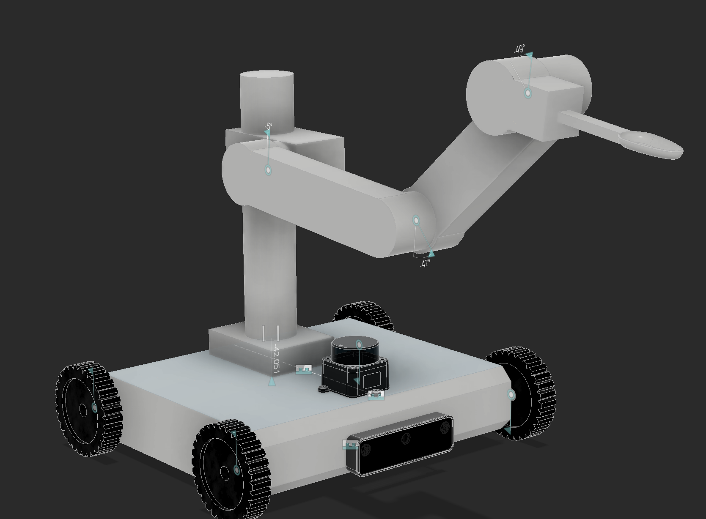
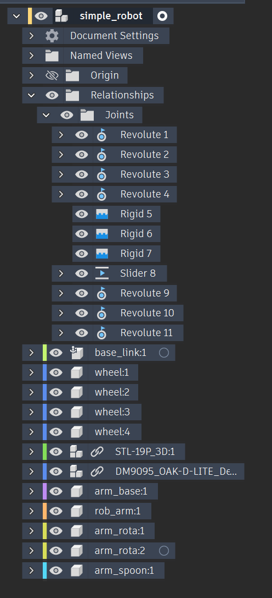
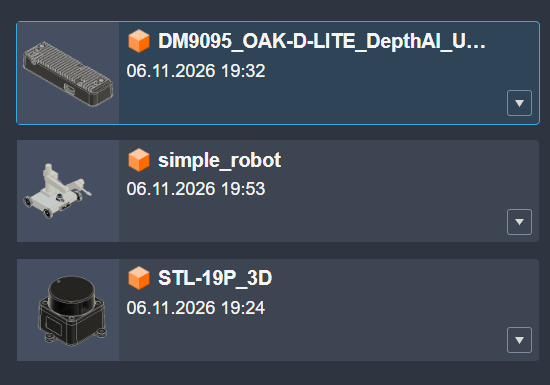
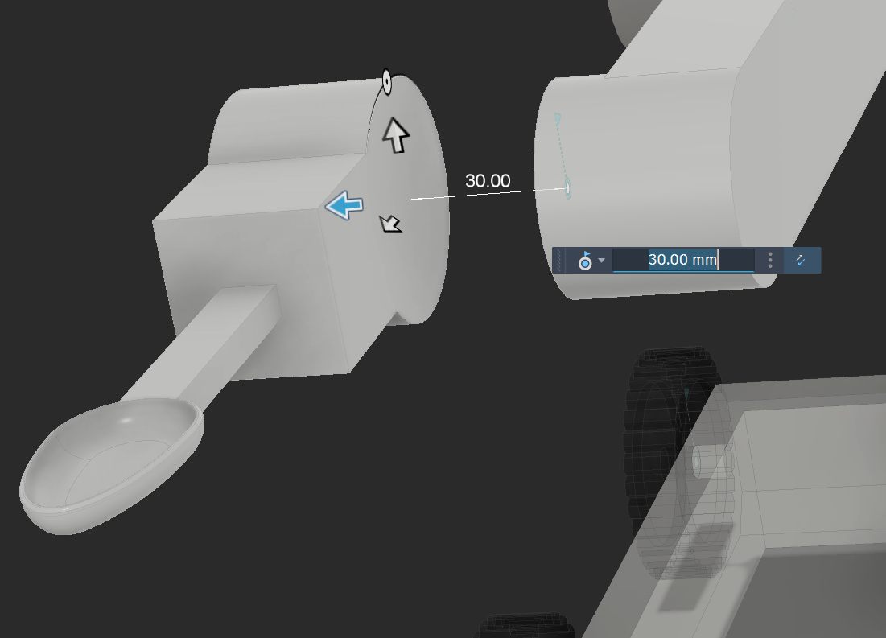
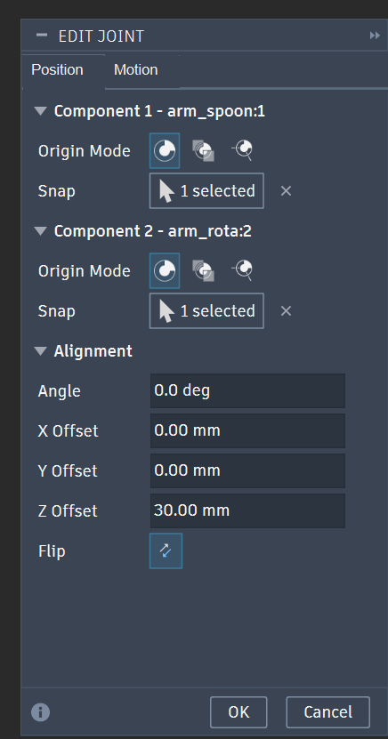
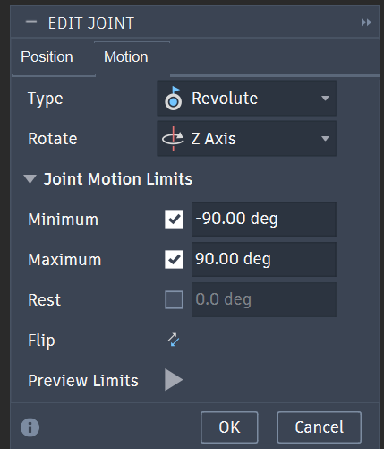
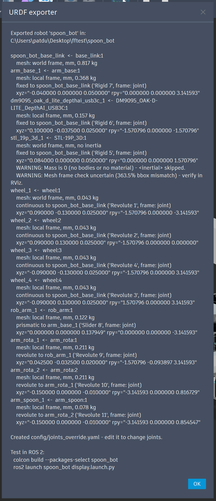

# fusion_ros_urdf_exporter

A Fusion 360 script that exports the open design to a ready-to-build
**ROS 2 description package** (ament_python). The package contains:

- a xacro file with real joints
- STL meshes
- masses and inertia
- a joint config you can edit
- a launch file and an RViz config

It works for any robot model.

Full documentation: [docs/](docs/README.md).
### Example robot (Spoon bot)


## Install

Clone this repository into Fusion's scripts folder, so that the folder name
matches the script name (`fusion_ros_urdf_exporter`):

| OS | Scripts folder |
|---|---|
| Windows | `%APPDATA%\Autodesk\Autodesk Fusion 360\API\Scripts\` |
| macOS | `~/Library/Application Support/Autodesk/Autodesk Fusion 360/API/Scripts/` |

```bash
git clone https://github.com/X-Lemon-X/fusion_ros_urdf_exporter.git
```

Or, in Fusion: open **Utilities → Add-Ins → Scripts and Add-Ins**
(Shift+S), press **+** and point it to the cloned folder. Then select the
script and press **Run**.

## Guide: preparing the model in Fusion

The example is **spoon_bot** (picture above). It is a 4-wheel base with a
camera, a lidar, a vertical slider and a 3-joint arm with a spoon.

### 1. One component per link



- Make a **top-level component named `base_link`**. It becomes the root
  link `<package>_base_link`.
- Every other **visible top-level component becomes one link**. The link
  name is the occurrence name in lower case, with `:` replaced by `_`
  (`arm_rota:2` → `arm_rota_2`).
- **Subcomponents are merged into their top-level parent.** Their bodies go
  into the parent's mesh, mass and inertia.
- **Parts can come from other designs.** A top-level component does not
  have to be modelled in the robot design. It can be inserted from another
  design, for example:

  - a vendor sensor
  - a gripper
  - a whole arm

  In spoon_bot, for example, the lidar (`STL-19P_3D`) and the camera
  (`DM9095_OAK-D-LITE...`) are separate designs in the project, next to the
  robot (`simple_robot`):

  

  An inserted design shows up as a linked component (chain icon) and is
  treated like any other top-level component:

  - one link, with its subcomponents merged in
  - joints work the same way
  - without a joint, it is fixed to `base_link`
- **Hidden components are skipped** (light bulb off).
- **Copies of one component** (`wheel:1` … `wheel:4`) are fine. Each copy
  gets its own link.

### 2. Joints

Joints between top-level components build the tree. In every joint:

- **component 1 is the child**, the part that moves
- **component 2 is the parent**

| Fusion joint | Exported as | In spoon_bot |
|---|---|---|
| Rigid | `fixed` | camera, lidar, `arm_base` → `base_link` |
| Revolute **without** limits | `continuous` | the 4 wheels → `base_link` |
| Revolute **with** both limits | `revolute` | the 3 arm joints |
| Slider with both limits | `prismatic` | `rob_arm` → `arm_base` |
| Cylindrical, pin-slot, planar, ball | `fixed` + warning | – |

- **A component without a joint is fixed to `base_link`.** Use this for
  vendor sensors: drop the sensor in and put its component origin where the
  sensor frame should be.
- **The joint frame becomes the link frame**, with Z as the joint axis.
- **A slider needs both limits.** Without them it is exported with
  `lower = upper = 0` and a warning.
- **Each component can have only one parent.** Closed loops are not
  allowed.

#### Making a joint (example: the spoon on the arm)

1. **Assemble → Joint.** Pick the point on the **moving part first**
   (component 1, `arm_spoon:1`), then the point on the part it is mounted
   on (component 2, `arm_rota:2`). Snap to the centre of the round face, so
   that the joint sits on the real rotation axis.

   

2. **Position tab.** Check that component 1 is the child. Offsets are
   allowed: here the spoon sits 30 mm away along the axis (Z Offset).
   **Flip** turns the part around if it faces the wrong way.

   

3. **Motion tab.** Choose the type: **Revolute** or **Slider**, or
   **Rigid** for parts that don't move. Choose the axis, then switch on
   **both** Minimum and Maximum to get a `revolute` joint with limits.
   Leave them off for a wheel (`continuous`).

   

### 3. The pose you export in becomes zero

The URDF zero of every joint is **the position the joint has in Fusion when
you export**. The limits are shifted to match.

In the picture, the slider is at −42 mm and the arm is at −5°, −47° and
−49°. In ROS that pose becomes 0 on every joint. If you want a clean zero
pose (for example the arm stretched out), move the model there before
exporting.

### 4. Materials

Mass and inertia come from Fusion's physical properties. **Give every body
a material.** A component without mass gets no `<inertial>`, and the
summary shows a warning.

### 5. Run the export

Run the script. In the folder dialog, **create a new folder named after
your robot**, for example `spoon_bot`. The folder name is the package name.
It must be lowercase letters, digits and `_`, starting with a letter.

| Folder | What happens |
|---|---|
| empty | the package is exported |
| a previous export of this script | it is regenerated; `config/joints_override.yaml` and files you added are kept |
| anything else | the script refuses and writes nothing |

### 6. Check the summary



The summary is also printed in **Text Commands**. For each link it shows:

- the source component
- the mesh frame
- the mass
- the joint (type, parent, Fusion joint name)
- the joint pose
- any warnings

| Warning | What to do |
|---|---|
| `Mass is 0 (no bodies or no material)` | Assign a material and export again. |
| `Mesh frame check uncertain ... verify in RViz` | Check the part in RViz. |
| `Joint '...' is cylindrical - exported as fixed` | Use a revolute or slider joint, or set `type` in the override. |
| `Slider '...' has no limits` | Enable both limits in Fusion, or set `lower`/`upper` in the override. |

`mesh: world frame` on a component that sits at the world origin (here
`base_link`, `wheel_1`) is normal.

## Output

```
<package>/
  package.xml, setup.py, setup.cfg
  resource/<package>
  <package>/__init__.py
  urdf/<package>.urdf.xacro      links + joints (regenerated)
  urdf/fusion_joint.xacro        the joint macro
  config/joints.yaml             joint settings from Fusion (regenerated)
  config/joints_override.yaml    YOUR changes (never overwritten)
  meshes/*.stl
  launch/display.launch.py
  rviz/display.rviz
  .fusion_urdf_export            list of generated files
```

## Viewing in ROS 2

```bash
cp -r <package> ~/ros2_ws/src/
cd ~/ros2_ws && colcon build --packages-select <package>
source install/setup.bash
ros2 launch <package> display.launch.py
```

The launch file starts three nodes:

- `robot_state_publisher`
- `joint_state_publisher_gui`, which shows one slider per joint
- RViz

Move each slider and check that every part turns or slides about the right
axis.

## Changing joints without touching Fusion

Edit `config/joints_override.yaml`. Any key you set wins over
`config/joints.yaml`. The change applies at the next `ros2 launch`; you do
not need to export again.

Example for spoon_bot:

- The right wheels turn about −Y and the left wheels about +Y, so the same
  speed drives the two sides in opposite directions. Flip the right side.
- Give one arm joint its real effort and speed.

```yaml
wheel_1_joint:
  flip: true
wheel_3_joint:
  flip: true
arm_rota_1_joint:
  effort: 2.0
  velocity: 1.5
```

All keys:

```yaml
wheel_left_front_1_joint:
  type: continuous      # fixed | revolute | continuous | prismatic
  flip: true            # reverse the axis (and the limits)
  axis: [0.0, 0.0, 1.0] # in the child link frame
  lower: -1.0           # rad or m, relative to the export pose
  upper: 1.0
  effort: 10.0          # N m or N
  velocity: 1.0         # rad/s or m/s
  frame: origin         # joint | origin – applied on the next export
```

`frame: origin` uses the component origin as the link frame instead of the
Fusion joint frame. Use it when a joint in Fusion is badly placed.

## Troubleshooting

| Symptom | Fix |
|---|---|
| All joints `fixed` with "no joint" | Add joints between the top-level components (component 1 = child). |
| `continuous` instead of `revolute` | Enable both limits on the Fusion joint. |
| Part turns the wrong way | `flip: true` in the override. |
| Part turns about the wrong point | Fix the joint in Fusion, or `frame: origin` and export again. |
| Wrong mass | Assign materials. |
| Script refuses the folder | Choose an empty folder or a previous export. |

## Tests

The tests run outside Fusion with a fake `adsk` module and simulated designs:

```bash
python -m unittest discover -s tests -v
```

With `pip install xacro` one more test runs the generated package through
real xacro.

## License

MIT
